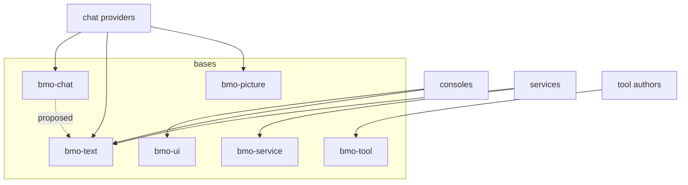

# Base separations: the plan

The plan for taking the copies of shared code out of the bmo repositories and putting each one in a base
library. No code moves in this document's own change: it states what stands now, which repository holds which
copy, which base library receives it, what changes at the boundary, and the order the swaps are filed in.

## The rule this plan answers to

- **A foundation library stands under `base/`**, a content-only repository under `resources/`, and everything
  else under `services/` or `tools/`.
- **A repository holds only what it uses.** Two repositories holding the same thing is the fault this plan
  removes.
- **A downstream keeps no copy of what an upstream serves.** It takes the upstream and pins its version.
- **Repositories reach each other through standard APIs alone.** A base library is the one kind of repository
  another may import; a service publishes its client for its callers.
- **A base stays generic.** It supplies the mechanism and a safe default; the consumer supplies the policy. No
  service name, route or field of one consumer stands in a base.

## What was surveyed

- **37 git checkouts, 6,333 tracked files.** The three bases (`base/chat`, `base/text`, `base/ui`), the two
  content repositories (`resources/persona`, `resources/skills`), 30 service checkouts, and `tools/news` and
  `tools/stock-index`.
- **`tools/privacy-scan` is one script in no repository.**
- **The checkouts outside the graph** are three private units' checkouts and
  the non-repository folder; every other checkout is registered with the code graph.
- **The boundaries read:** each base's `docs/boundary.md` or `docs/contract.md`, `docs/api.md` and `docs/design.md`;
  each service's `docs/boundary*`, `docs/api.md`, `docs/design.md` and `testbed.toml`.
- **The methods:** a content-hash sweep of every tracked source file across checkouts (81 groups of identical
  files across two or more repositories), manifests and `testbed.toml` dependency declarations, a sweep for the
  exported names of every base module, and reading the candidate files themselves.

The old bmo tree holds several of these modules in one place; its counterpart is named with each group below.

## The shape

A solid line is a dependency that stands today or is the move itself; the dotted line is the one base-to-base
dependency this plan proposes.

## The base libraries

### Existing

- **`base/text` (bmo-text)** serves markdown readings, the wording net, the dash net, the English test, web
  addresses, HTML reading, the answer ceiling, translation parts and finding markdown, as a Rust crate, a
  TypeScript package and an MCP server. It depends on nothing.
- **`base/chat` (bmo-chat, bmo-chat-client)** serves the chat contract: the provider declaration, read modes,
  capabilities, dialects, messages, sends, refusals and the wire protocol. The two libraries deliberately
  define the wire shapes apart and depend on nothing `bmo-*`.
- **`base/ui` (bmo-ui)** serves the Nuxt layer: 46 components, the domain and shared modules, 90 wording keys,
  tokens, styles, fonts, the console bundle contract and the harness plugin. It stands on registry packages
  alone.

### New

Three new bases keep the set small; every other group joins one of these or an existing base.

- **`base/tool` (bmo-tool)** — the contract every tool of the tool host is written to: a call's handed request,
  its answer, its session record, its manifest, its input schemas and its resources. Its seed is the contract
  crate that stands in `services/pocket/sdk/contract` (the fullest copy) merged with the tool-side protocol in
  `services/receiver/crates/tool-call` (the fuller of the two tool-call crates). Its old-bmo counterpart is
  `tool-host/bmo-tool`. A tool author — a service, a repository's `tools/` folder or a repository of its own —
  depends on it; the host (pocket) depends on it too.
- **`base/picture` (bmo-picture)** — a picture read, its type told, its transparency read and it redrawn as
  JPEG on white. Its seed is the old tree's `core/bmo-picture`, whose `avif` and `svg` readers are already
  identical in both provider copies. The provider supplies the policy: which types it takes, the size it keeps,
  the quality it writes and whether it redraws at all.
- **`base/service` (bmo-service)** — the service substrate: the common wire shapes (an error of a code and a
  sentence, a page of items and whether more stand past them), the refusal mapping to a status, the settings
  loader, the clock, the route and tool tables, the OpenAPI document builder and the MCP server over a tool
  table. It knows no service; each service supplies its routes, tools, configuration type, time policy and
  code set. Its old-bmo counterparts are `tool-host/mcp-host` for the server skeleton and `core/seoul-clock`
  for the clock; the wire, settings and OpenAPI skeletons have no single old crate and were rewritten per
  service.

### Service clients

A service publishes its client in its own repository, as a crate named `bmo-<service>-client` or a package
named `bmo-<service>-client`, versioned with the service and pinned exactly by its callers. The caller lists it
under `base_libraries` in `testbed.toml` and imports it; it never restates the client's types. That mechanism
already stands: agency imports `bmo-brain-client` and `bmo-node-client`, review imports `bmo-job-client`, and
artifact imports `bmo-explorer`; no repository holds a private copy of another service's client
types today. The plan files no move for it.

## The copies, group by group

| Group | Copies held | Drift that matters | Best copy | Base | Old-bmo counterpart |
| --- | --- | --- | --- | --- | --- |
| Telegram markdown and plain rendering | `telegram/dialect` (about 1,800 source lines and 270 test lines), `gate/crates/markup` (about 2,700 source lines and 460 test lines) | Both are earlier readings: an address carries no label, the dash reading returns no count, and gate's English test is a reduced form | `base/text` | bmo-text | `markup/bmo-markup` |
| Web address reading | gate (188 lines), telegram (188), receiver (195), artifact client (44), web client (178), kakaotalk (a two-prefix test) | Receiver reads Hangul spans from its own policy table; the clients are full JavaScript rewrites | `base/text` | bmo-text | `markup/bmo-markup` |
| Dash correction | gate (385 lines), receiver (384) | Earlier form: the reading gives the text but not how many dashes it replaced | `base/text` (424 lines) | bmo-text | `markup/bmo-markup` |
| Answer ceiling | artifact, pocket, explorer (124 lines each) | A different wording struct with borrowed fields; the three case files differ in their cases | `base/text` (141 lines) | bmo-text | `tool-host/bmo-tool/src/ceiling.rs` |
| HTML reading | artifact (329 lines) | A different reader: scraper-based, with its own description rule, against bmo-text's streaming reader | `base/text` (357 lines) | bmo-text | `markup/bmo-markup` |
| Markdown plain rendering | `base/chat/provider/src/plain.rs` (about 70 lines) | Re-reads markdown with the parser to strip its marks; bmo-text already answers the plain form | `base/text` | bmo-text | none |
| Tool contract and call protocol | pocket `sdk/contract` (9 modules), explorer `src/tool` (6 near-copies), agency `crates/tool-call` (305 lines), receiver `crates/tool-call` (626 lines) | The session model drifted 133 lines between explorer and pocket; receiver's answer carries structured content that agency's does not; the host side is fuller in pocket | pocket's contract with the receiver's tool side | bmo-tool (new) | `tool-host/bmo-tool` |
| Picture reading and redrawing | telegram and kakaotalk picture crates (about 650 lines each) | `avif` and `svg` are identical; the policy differs — Telegram adds icon detection and a size limit, KakaoTalk lays every picture on white | the common core of both | bmo-picture (new) | `core/bmo-picture` |
| MCP server skeleton | 19 files in 17 repositories, each with the same schema flattening, tool table and server smoke | The skeleton is copied; only the tools differ. Graph's and mail's are the fullest and carry the same parts | graph's or mail's server | bmo-service (new) | `tool-host/mcp-host` |
| Wire error and page | 19 files in 18 repositories | The error is the same two fields everywhere; the page is the same two fields everywhere | graph's wire module | bmo-service (new) | none (per-service rewrites) |
| OpenAPI document builder | 24 files in 22 repositories | The builder's parts — schema of a type, query parameters, operation, document — are the same jobs; the documents differ | graph's and mail's builders | bmo-service (new) | none (per-service rewrites) |
| Clock | five implementations in four repositories | Independent types: seconds, milliseconds, local time; only job and explorer carry a test clock | job's system/manual clock with explorer's trait | bmo-service (new) | `core/seoul-clock` |
| Settings loader | 12 configuration modules in 12 repositories | Keys and sections differ; the loading job (one TOML file, unknown keys refused, read once) is the same | brain's and job's loaders | bmo-service (new) | none |
| Refusal and status mapping | 31 refusal sites across the services | Each wraps its own code set; the shape (status, kebab-case code, English sentence) is the same | job's refusal | bmo-service (new) | none |
| Client page macro | node and song (identical), arbiter and job (near copies) | None that matters | node's | bmo-service (new) | none |
| Personal-data check | 23 repositories, 153 to 251 lines each, five identical | Each copy adds its repository's own allowed forms | testbed's suite | testbed (a quick check) | `testbed/test-support` |
| bmo-ui layer | face (components, five domain modules, fonts), web (two domain modules), artifact and drive (a clipboard module) | face's copies predate the layer; web's are earlier console versions; the clipboard module is duplicated exactly | `base/ui` | bmo-ui | none |

## Repository rows

One row is one item BMO files. A row lists every copy in that repository and every library it takes. Rows are
independent unless the order says otherwise.

| Row | Repository | Copies now held | Base taken | Boundary change |
| --- | --- | --- | --- | --- |
| R1 | `services/gate` | `crates/markup/src/{markdown,web_address,dashes,format,js,english,wording,telegram}.rs`; the bmo-ui release under `client/vendor/` | bmo-text; bmo-ui | Add `bmo-text` to the manifest and `base_libraries`; delete the copied modules; keep `crates/markup/src/text.rs` (gate's count, number and month readings) and pass gate's own glossary path and policy into the base's wording net; adapt the tests under `tests/markup/`; update the vendored layer to `0.1.0-rev.5` |
| R2 | `services/telegram` | `dialect/src/{markdown,web_address,format,js}.rs`; `picture/src/{avif,svg}.rs` and the redrawing in `lib.rs` | bmo-text; bmo-picture | The dialect crate depends on `bmo-text` and keeps its limits and `ChatDialect` implementation; the picture crate keeps only its platform policy over `bmo-picture` |
| R3 | `services/receiver` | `src/web_address.rs`, `src/dashes.rs`, `crates/tool-call`, `crates/receiver-client/src/wire.rs` | bmo-text; bmo-tool; bmo-service | Delete the two readings and call `bmo-text`; replace `crates/tool-call` with `bmo-tool`; the client's wire shapes come from `bmo-service`; its Hangul span table goes, since the base states the same letters |
| R4 | `services/artifact` | `src/helpers/ceiling.rs`, `src/documents/page_reading.rs`, `client/app/domain/web-address.ts`, `client/app/domain/copy.ts`; bmo-ui release under `client/vendor/`; `src/mcp/`, `src/wire.rs`, `src/openapi.rs`, `src/plumbing/openapi.rs` | bmo-text; bmo-ui; bmo-service | Take the crate and the package; delete the ceiling, the web-address copy and the local HTML reader, keeping only the description rule if the base's reading does not answer it; take the clipboard from the layer and update the vendored layer; take the server skeleton from `bmo-service` |
| R5 | `services/pocket` | `sdk/contract/src/*` (the tool contract and an answer ceiling), `host/src/{handler,toolbook}.rs`, `client/src/{wire,error,openapi}.rs` | bmo-text; bmo-tool; bmo-service | Move the contract crate to `base/tool` and depend on it; the ceiling goes to `bmo-text`; the host skeleton and the client shapes come from `bmo-service` |
| R6 | `services/explorer` | `src/tool/{ceiling,input,kept,manifest,protocol,resources,session}.rs`, `src/mcp.rs`, `src/wire.rs`, `src/openapi.rs`, `src/web/clock.rs` | bmo-text; bmo-tool; bmo-service | The ceiling goes to `bmo-text`; the six near-copies go to `bmo-tool`, keeping `served.rs` and the site-tool trait; the server, wire, OpenAPI and clock come from `bmo-service` |
| R7 | `services/web` | `client/apps/web/shared/web-address.ts`, `shared/translation-parts.ts`, `app/domain/numbers.ts`, `app/domain/player.ts`, `server/client/src/{wire,openapi}.rs` | bmo-text; bmo-ui; bmo-service | Take the package and delete the two readings; use the layer's number and player modules; take the server client shapes from `bmo-service`; the vendored package named `bmo-markup` is declared but unused — use it or remove it in the same change |
| R8 | a private unit | `src/addresses.rs` (a two-prefix address test), `picture/src/{avif,svg}.rs` and the redrawing in `lib.rs` | bmo-text; bmo-picture | Call the base's address test; the picture crate keeps only its platform policy |
| R9 | `base/chat` | `provider/src/plain.rs` (the markdown stripped to words) | bmo-text | The chat base depends on `bmo-text` and its dependency test and boundary document change from "nothing `bmo-*`" to "`bmo-text` alone"; this is the one base-to-base edge and is decided before it is filed |
| R10 | `services/face` | `client/app/components/{MessageIsland,NumberInput}.vue`, `client/app/domain/{island,layers,numbers,overlays,screen}.ts`, the Pretendard and Caskaydia font copies | bmo-ui | Add the layer to the package and the Nuxt configuration, add the layer's wording keys to the pack, delete the copied components, modules and fonts, keep the editor's own components |
| R11 | `services/drive` | `client/app/domain/copy.ts`; the bmo-ui release under `client/vendor/`; `src/mcp/`, `src/wire.rs`, `src/openapi.rs` | bmo-ui; bmo-service | Take the clipboard from the layer; update the vendored layer to `0.1.0-rev.5`; take the server skeleton from `bmo-service` |
| R12 | `services/mail` | the bmo-ui release under `client/vendor/`; `src/mcp.rs`, `src/wire.rs`, `src/openapi.rs` | bmo-ui; bmo-service | Update the vendored layer to `0.1.0-rev.5`; take the server skeleton from `bmo-service` |
| R13 | `services/remote` | the bmo-ui release under `client/vendor/`; `src/wire.rs`, `src/openapi.rs` | bmo-ui; bmo-service | Update the vendored layer to `0.1.0-rev.5`; take the wire shapes and documents from `bmo-service`; the terminal fonts stay, they are the service's own |
| R14 | `services/review` | the bmo-ui release under `client/vendor/`; `src/mcp.rs`, `src/wire.rs`, `src/openapi.rs` | bmo-ui; bmo-service | Update the vendored layer to `0.1.0-rev.5`; take the server skeleton from `bmo-service` |
| R15 | a private unit | the bmo-ui release under `client/vendor/`; `src/mcp.rs`, `src/wire.rs`, `src/settings.rs`, `src/openapi.rs` | bmo-ui; bmo-service | Update the vendored layer to `0.1.0-rev.5`; take the server skeleton, wire shapes and document builder from `bmo-service`; its graph settings schema stays |
| R16 | `services/voice` | the bmo-ui release under `client/vendor/` in the studio; `src/mcp.rs`, `src/wire.rs`, `src/openapi.rs` | bmo-ui; bmo-service | Update the vendored layer to `0.1.0-rev.5`; take the server skeleton from `bmo-service` |
| R17 | `services/agency` | `crates/tool-call/*`, `crates/server/src/{mcp,openapi}.rs`, and its clock and configuration modules where they restate the common shapes | bmo-tool; bmo-service | Replace the tool-call crate with `bmo-tool`; take the server skeleton and common shapes from `bmo-service` |
| R18 | `services/arbiter` | `crates/plugin/src/server.rs`, `crates/client/src/{page,error,openapi}.rs` | bmo-service | Take the server skeleton and client helpers from `bmo-service` |
| R19 | `services/brain` | `src/mcp/*`, `src/wire.rs`, `src/config.rs`, `src/openapi.rs`, `crates/client/src/wire.rs` | bmo-service | Take the server skeleton, wire shapes, settings loader and document builder from `bmo-service`; the configuration keys stay |
| R20 | `services/cache-siren` | `src/mcp.rs`, `src/wire.rs`, `src/clock.rs`, `src/openapi.rs` | bmo-service | Take the skeleton, shapes, clock and builder; its local and transcript time rules stay |
| R21 | `services/cache-warmer` | `src/mcp.rs`, `src/wire.rs`, `src/clock.rs`, `src/openapi.rs` | bmo-service | Take the skeleton, shapes, clock and builder |
| R22 | `services/job` | `crates/plugin/src/{server,openapi}.rs`, `src/{clock,settings,refusal}.rs`, `crates/client/src/{page,openapi}.rs` | bmo-service | Take the server skeleton, clock, settings loader, refusal shape and client page from `bmo-service`; the code set and settings keys stay |
| R23 | a private unit | `client/src/{wire,types,openapi}.rs` | bmo-service | Take the common wire shapes and document builder; the platform types stay |
| R24 | `services/node` | `crates/plugin/src/{server,openapi}.rs`, `crates/client/src/{page,error}.rs` | bmo-service | Take the server skeleton, page and error shape |
| R25 | a private unit | `crates/plugin/src/{server,openapi}.rs`, `crates/client/src/{page,error}.rs` | bmo-service | Take the server skeleton, page and error shape |
| R26 | `services/testbed` | `plugin/src/{server,openapi}.rs`, `client/src/error.rs`, `suite/tests/integration/personal_data.rs` | bmo-service | Take the server skeleton; add the personal-data check to its suite and drop the repository test (this row also owns the check) |
| R27 | `services/cli` | `tests/personal_data.rs` | testbed | Drop the repository test and add the check to `testbed.toml` |
| R28 | `services/discord` | `tests/personal_data.rs` | testbed | Drop the repository test and add the check to `testbed.toml` |
| R29 | a private unit | `tests/personal_data.rs` | testbed | Drop the repository test and add the check to `testbed.toml` |

## Base-side items

- **A1 — `base/tool` (bmo-tool).** Built from pocket's contract crate and receiver's tool side. Its exports are
  the handed request, the answer, the session record, the manifest, the input schemas and the resources. It
  owns the cases both crates already keep. Consumers: R3, R5, R6, R17.
- **A2 — `base/picture` (bmo-picture).** Built from the common decode and redraw in the two provider crates,
  with the old tree's reader as its counterpart. It exports the type reading, the transparency reading and the
  JPEG redraw; the target size, quality and format remain the provider's. Consumers: R2, R8.
- **A3 — `base/service` (bmo-service).** Built from graph's server and wire modules, job's clock, refusal and
  settings, and mail's document builder. It exports the error and page shapes, the refusal mapping, the
  settings loader generic over the configuration type, the clock trait with a system and a manual
  implementation, the route and tool table types, the OpenAPI builder and the MCP server. It names no service.
  Consumers: every Rust service row. This is a new home and is designed before it is built.
- **R26 also carries the personal-data check.** The testbed's quick-check suite gains a check that reads a
  repository's own allowances and applies the rule the 23 copies apply today. Each repository row drops its
  copy and names the check in `testbed.toml`.

## Order

The order is by dependency; within a phase the rows are independent and may be filed at once. A row that takes
more than one base has one part per base, and each part lands where its base is ready.

1. **The personal-data check in R26** — first, so every later row can drop its copy. The rest of R26 waits for
   `bmo-service`.
2. **A1 and A2** — the two small bases, then their consumer rows.
3. **The bmo-text rows** — R8, R7, R4, R5, R6, R3, R2, R1. The base is ready; the order moves from the
   smallest copy to the largest. R9 waits for the decision on a base-to-base dependency.
4. **The bmo-ui rows** — R10 (the adoption), R7 and R4 and R11 (the module copies), then the version updates
   R12, R13, R14, R1, R15, R16.
5. **The bmo-tool rows** — R17, R3, R5, R6, after A1.
6. **The bmo-picture rows** — R2, R8, after A2.
7. **A3 and the bmo-service rows** — R15 is the pilot: graph builds against `bmo-service` first, its OpenAPI
   document and its tests unchanged. Then R12, R16, R19, R22, R3, R17, R4, R6, R5, R20, R21, R11, R14, R26,
   R24, R25, R18, R13, R23, R7.
8. **R9** — the chat base's plain reading, after the decision.
9. **R27, R28, R29** — the three repositories whose only copy is the personal-data test.

## Checks each move must pass

**Every repository row**

- `bmo check` while the change is written: the repository's quick checks (`layout`, `dependencies`, and
  `korean` or `wording` where its `testbed.toml` names them), its static check and the tests it touched. Every
  step runs to its end and the log is read.
- The repository's own suite through `bmo testbed run`, at the end of the row. The close runs the full suite
  once.
- The `dependencies` quick check passes: only registry packages and the base libraries named in
  `testbed.toml`. The new base is named there and pinned to its exact version in the manifest.
- The repository's boundary document names the new dependency and stops stating what the base now states.
- Where the repository keeps an OpenAPI document, it is byte-identical after the row; a route change is not
  part of any row.

**A Rust row**

- `cargo check --all-targets`, `cargo clippy --all-targets --all-features -- -D warnings` and
  `cargo fmt --check` pass, and the tests that read the deleted module are adapted to the base's cases.

**A TypeScript row**

- `bun run check` passes in the client. Where the change takes the bmo-text package, the package is built
  (`bun run build` in `base/text/package`) before the tests run, so the build is never older than the crate.

**A base item**

- The base's own checks and suite pass; its boundary, API and inventory documents name what it now serves and
  what it dropped; `VERSION` and every manifest carry the new number together.
- For `bmo-text`, the crate's checks and tests pass and the package is built before its tests.
- For `bmo-ui`, the guard test passes and the layer's wording-key list is unchanged unless the layer itself
  changed.
- A consumer's build against the new base is the acceptance check: the first row that takes it proves the
  boundary.

## Not moved, and why

- **Vendored bmo-ui release tarballs** are the documented delivery of the layer, not copies of its source. The
  stale ones are updated in their repository row.
- **The `reka-ui` patch** is the host's documented copy of a base file; the layer's boundary document states
  that the host applies it.
- **Generated OpenAPI documents** (`docs/openapi.json`, `package/openapi.d.ts`) are derived from the code and
  are not copies.
- **`rustfmt.toml`, `tsconfig.json`, `i18n.d.ts`** are configuration, not shared code.
- **Content copies** are outside this plan: the worker plugin skills under `services/agency` duplicate the
  content repository `resources/skills`, and some of the gate's agent prompts duplicate agency's. They belong to
  a content-separation item, not a base library.
- **Test-only helpers** (`tests/support/binary.rs`, `tests/layout.rs`, the `alone` test fixture) are
  duplicated between two repositories each. They are folded into `bmo-service`'s test support only where the
  service row already touches them; they justify no item of their own.
- **Gate's small text readings** (the count, the fixed number, the months a piece spans, the fenced blocks of
  a prose, the untranslated mark) stay in gate: bmo-text does not serve them and no second consumer exists.
- **The provider picture policy** (Telegram's icon type and size, KakaoTalk's white ground) stays with the
  provider; the base takes the mechanism.
- **Two private units' checkouts, the content repositories and the two tools repositories**
  hold no copy of base code. Their vendored files are published clients taken as delivered.

## The count

**32 moves.** Three base-side items (A1 to A3) and 29 repository rows (R1 to R29). A row is one item BMO files;
a base item is filed once and its consumers follow in their own rows. R26 is one row that also carries the
personal-data check.
